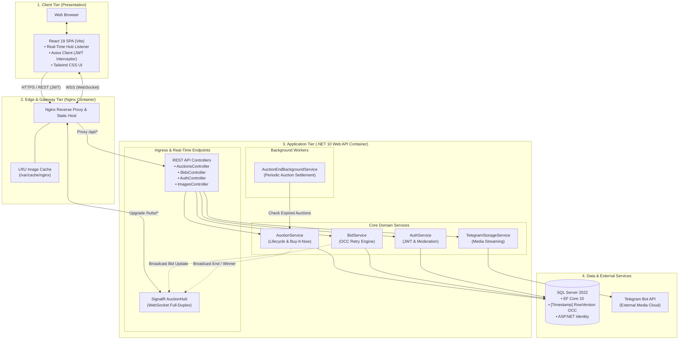
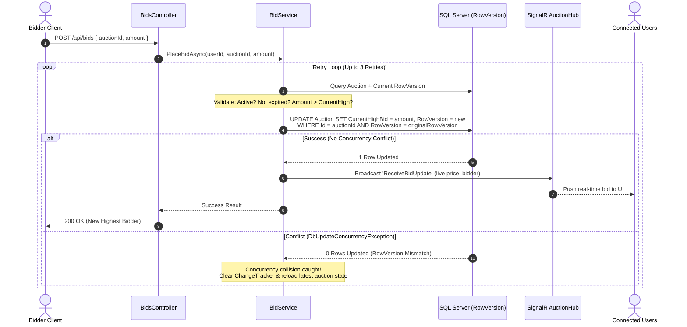

# 🏷️ AuctionOx

[](https://dotnet.microsoft.com/)
[](https://react.dev/)
[](https://www.docker.com/)
[](https://www.microsoft.com/sql-server)
[](https://learn.microsoft.com/aspnet/core/signalr/)
[](LICENSE)

**AuctionOx** is a high-throughput, enterprise-ready real-time auction platform engineered with **.NET 10 Web API**, **React 19**, and **SQL Server 2022**. It features distributed **Optimistic Concurrency Control (OCC)**, **SignalR WebSocket live streaming**, **Nginx edge micro-caching**, and **decoupled cloud media storage via the Telegram Bot API**.

---

## 📑 Table of Contents

- [System Architecture](#-system-architecture)
  - [Tiered Structure & Flow](#tiered-structure--flow)
- [Key Engineering Highlights](#-key-engineering-highlights)
  - [1. Database-Level Optimistic Concurrency Control (OCC)](#1-database-level-optimistic-concurrency-control-occ)
  - [2. Edge Reverse Proxy & Micro-Caching](#2-edge-reverse-proxy--micro-caching)
  - [3. Live SignalR Broadcasting & Notifications](#3-live-signalr-broadcasting--notifications)
  - [4. Decoupled Cloud Media Storage](#4-decoupled-cloud-media-storage)
  - [5. Role Moderation & Security Hardening](#5-role-moderation--security-hardening)
- [Technology Stack](#-technology-stack)
- [Project Structure](#-project-structure)
- [Getting Started](#-getting-started)
  - [Prerequisites](#prerequisites)
  - [Docker Compose Quickstart](#docker-compose-quickstart)
  - [Local Development Setup](#local-development-setup)
- [Testing Suite](#-testing-suite)
- [License](#-license)

---

## 🏛️ System Architecture

### Tiered Structure & Flow



---

## ⚡ Key Engineering Highlights

### 1. Database-Level Optimistic Concurrency Control (OCC)

High-traffic auctions experience bursts of concurrent bids in the final seconds before closing. Rather than using in-memory locks (`SemaphoreSlim`) that bottleneck throughput and fail across distributed horizontal instances, **AuctionOx** utilizes database-level **Optimistic Concurrency Control** via SQL Server `[Timestamp] byte[] RowVersion`.



- **Conflict Detection**: EF Core appends `WHERE RowVersion = @originalRowVersion` to update queries. If another bidder commits first, the version changes and EF Core throws a `DbUpdateConcurrencyException`.
- **Automatic Retry Engine**: `BidService` catches the exception, clears the `ChangeTracker`, refreshes the latest auction state from the database, validates whether the bid remains higher than the new price, and retries up to 3 times before returning a clean domain response.

### 2. Edge Reverse Proxy & Micro-Caching

An **Nginx** reverse proxy sits in front of the application:
- **On-Disk Image Caching (`proxy_cache IMAGE_CACHE`)**: Caches decoded auction images for up to 30 days (`max_size=2g`, `inactive=30d`).
- **Cache Stampede Prevention**: Utilizes `proxy_cache_lock on;` so that when hundreds of clients request the same new auction listing, only the first request reaches the backend API while subsequent requests wait and serve from cache.
- **Stale Cache Serving**: With `proxy_cache_use_stale updating error timeout`, clients receive cached responses seamlessly even during backend service restarts.
- **WebSocket Gateway**: Transparently proxies `/hubs/` with HTTP/1.1 `Upgrade` and `Connection` headers for persistent SignalR connections.

### 3. Live SignalR Broadcasting & Notifications

- **Full-Duplex Hub**: [`AuctionHub`](file:///AuctionOx/Hubs/AuctionHub.cs) organizes connections into auction-specific groups (`auction_{id}`).
- **Zero-Latency Push**: Real-time events broadcasted include:
  - `ReceiveBidUpdate`: New high bid, bidder username, and updated countdown.
  - `AuctionEnded`: Immediate visual notification when an auction is won or expires.
  - `ReceiveNotification`: Outbid alerts pushed directly to the specific superseded bidder's connection.

### 4. Decoupled Cloud Media Storage

- Eliminates disk bloat and S3 storage costs by streaming validated images (strict 5 MB cap, MIME-type and magic-byte validation) directly to a dedicated channel via the **Telegram Bot API**.
- File IDs and URLs are mapped within the database, and Nginx micro-caches fetched binaries locally for lightning-fast subsequent reads.

### 5. Role Moderation & Security Hardening

- **Account Status Guard**: [`ValidateUserStatusAsync`](file:///AuctionOx/Controllers/BidsController.cs) verifies that users attempting to bid, create auctions, or buy items are active—blocking soft-deleted (`IsDeleted`), suspended, or locked-out accounts.
- **Role Hierarchy**: Elevated `Admin` capabilities to ban, suspend, soft-delete, or promote users to administrative roles, with safety guards preventing self-demotion or self-suspension.
- **Security-First Token Validation**: Centralized JWT token validation pipeline verifies user status on each request.

---

## 🛠️ Technology Stack

| Layer | Technologies |
|---|---|
| **Frontend** | React 19, Vite, Tailwind CSS, Lucide Icons, Axios, `@microsoft/signalr` |
| **Backend API** | ASP.NET Core (.NET 10), C# 13, EF Core 10, SignalR |
| **Identity & Auth** | ASP.NET Core Identity, JWT Bearer Tokens, Role-Based Access Control |
| **Database** | Microsoft SQL Server 2022 (Dockerized Linux image) |
| **Edge / Proxy** | Nginx (Alpine), Multi-tier Disk Micro-Caching, Reverse Proxy |
| **Storage** | Telegram Bot API (Decoupled Cloud Blob Storage) |
| **Testing** | xUnit, FluentAssertions, Moq, Testcontainers (SQL Server) |
| **Containerization** | Docker, Docker Compose, Multi-stage Dockerfiles |

---

## 📂 Project Structure

```
AuctionOx/
├── .github/                      # CI/CD Workflows
├── AuctionOx/                    # .NET 10 Web API Project
│   ├── BackgroundServices/       # Hosted Cron workers (AuctionEndBackgroundService)
│   ├── Controllers/              # REST Controllers (Auctions, Bids, Auth, Images)
│   ├── Data/                     # ApplicationDbContext & Entity Configurations
│   ├── DTOs/                     # Data Transfer Objects & Validation Requests
│   ├── Hubs/                     # SignalR Real-Time Hubs (AuctionHub)
│   ├── Migrations/               # EF Core Code-First Database Migrations
│   ├── Models/                   # Domain Entities (Auction, Bid, ApplicationUser)
│   ├── Services/                 # Business Logic (BidService, AuctionService, AuthService)
│   └── Dockerfile                # Multi-stage production build for API
├── AuctionOx.Tests/              # Automated Test Suite (Unit, Security, Integration)
│   ├── Controllers/              # Controller & Security Validation Tests
│   ├── Services/                 # Domain Services & OCC Retry Tests
│   └── Integration/              # Testcontainers-backed integration tests
├── docs/                         # Project Documentation & Architecture Assets
│   └── auctionox_architecture.jpg
├── frontend/                     # React 19 Single Page Application
│   ├── src/                      # Components, Pages, Hooks (useAuctionHub), Contexts
│   ├── nginx.conf                # Edge routing, caching, and WebSocket configuration
│   └── Dockerfile                # Multi-stage build (Node build -> Nginx runtime)
└── docker-compose.yml            # Complete stack orchestration (SQL Server, API, Frontend)
```

---

## 🚀 Getting Started

### Prerequisites

- [Docker Desktop](https://www.docker.com/products/docker-desktop/) (v24+)
- [.NET 10 SDK](https://dotnet.microsoft.com/download/dotnet/10.0) *(optional, for local backend development)*
- [Node.js 20+](https://nodejs.org/) *(optional, for local frontend development)*

### Docker Compose Quickstart

The fastest way to launch the entire stack (SQL Server, .NET 10 API, and React Frontend with Nginx):

1. **Clone the repository**:
   ```bash
   git clone https://github.com/Elshater44/AuctionOx.git
   cd AuctionOx
   ```

2. **Configure environment variables**:
   Create a `.env` file based on `.env.example`:
   ```env
   TELEGRAM_BOT_TOKEN=your_telegram_bot_token_here
   TELEGRAM_CHANNEL_ID=your_telegram_channel_id_here
   ```

3. **Start the containers**:
   ```bash
   docker compose up -d --build
   ```

4. **Access the application**:
   - **Frontend App**: [http://localhost:5173](http://localhost:5173) or [http://localhost:3000](http://localhost:3000)
   - **Backend REST API**: [http://localhost:5050](http://localhost:5050)
   - **Swagger OpenAPI Docs**: [http://localhost:5050/swagger](http://localhost:5050/swagger)

---

### Local Development Setup

If you prefer running services directly on your host machine:

#### 1. Start SQL Server
```bash
docker run -e "ACCEPT_EULA=Y" -e "MSSQL_SA_PASSWORD=AuctionOxP@ssw0rd!" -p 1433:1433 -d mcr.microsoft.com/mssql/server:2022-latest
```

#### 2. Run the .NET 10 Backend
```bash
cd AuctionOx
dotnet restore
dotnet ef database update
dotnet run
```

#### 3. Run the React Frontend
```bash
cd frontend
npm install
npm run dev
```

---

## 🧪 Testing Suite

AuctionOx maintains an extensive test suite covering unit tests, security assertions, domain rules, and optimistic concurrency behavior:

```bash
# Run all unit and security test suites
dotnet test --filter "FullyQualifiedName!~Integration&FullyQualifiedName!~Concurrency"
```

### Key Test Categories:
- **Security & Authorization Tests**: [`BidsControllerSecurityTests`](file:///AuctionOx.Tests/Controllers/BidsControllerSecurityTests.cs) and [`AuctionsControllerSecurityTests`](file:///AuctionOx.Tests/Controllers/AuctionsControllerSecurityTests.cs) assert that suspended, banned, soft-deleted, and unauthenticated users are barred from actions.
- **OCC Concurrency Tests**: Verifies retry mechanics upon simulated `DbUpdateConcurrencyException`.
- **Identity & Moderation Tests**: Validates admin role elevation, self-demotion blocks, and user lockout workflows.

---

## 📄 License

This project is licensed under the MIT License — see the [LICENSE](LICENSE) file for details.
